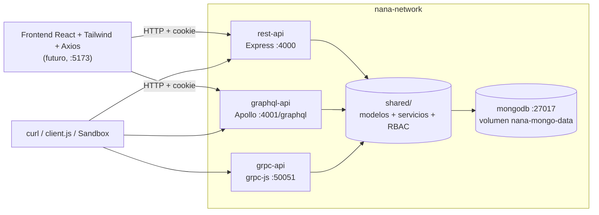

# 🐾 La Casa de la Nana — Sistema Integral de Gestión (Backend multiprotocolo)

Monorepo con **tres APIs (REST, GraphQL y gRPC)** que comparten **una sola base de datos MongoDB** y **una sola capa de dominio** (modelos, reglas de negocio y RBAC). Todo se orquesta con Docker Compose.

---

## 1. Contexto del proyecto

**La Casa de la Nana** es un hotel y guardería canina. El sistema centraliza y automatiza sus procesos operativos, logísticos y financieros, que antes se llevaban en libretas, hojas de cálculo y mensajes sueltos.

### Problema que resuelve
| Problema | Solución en el sistema |
|---|---|
| Sobreventa de habitaciones y traslapes de fechas | Motor de reservaciones con verificación de disponibilidad por habitación y por mascota |
| Perros con cartilla vencida que ingresan al hotel | Validación médica obligatoria (Rabia, Múltiple, Bordetella vigentes hasta la fecha de salida) antes del check-in |
| Mascotas geriátricas o con necesidades especiales en habitaciones inadecuadas | 4 zonas especializadas con reglas de asignación |
| Saldos sin cobrar al entregar a la mascota | El check-out se bloquea si existe saldo pendiente |
| Descuadres de caja | Caja fija por turnos: apertura con fondo, ingresos/gastos y cierre con arqueo (esperado vs. contado) |
| Decisiones sin datos | KPIs: ticket promedio, ingresos mensuales, ocupación por zona y tasa de cancelación |

### Roles (RBAC)
| Rol | Alcance |
|---|---|
| `ADMIN` | Acceso total: catálogo de habitaciones, usuarios, caja, reportes y KPIs |
| `STAFF` | Operación diaria: mascotas, reservaciones, validación médica, check-in/check-out, pagos y caja. En habitaciones solo puede cambiar `estado` y `notas` |
| `CLIENTE` | Tutor de mascotas: registra y consulta **solo sus** mascotas, cotiza, agenda y cancela **sus** reservaciones |

Seguridad: contraseñas con **bcrypt (12 rondas, librería `bcryptjs`)**, sesión con **JWT** enviado en **cookie HttpOnly** (`nana_token`, `SameSite=Lax`) o en el header `Authorization: Bearer <token>` (útil para curl, gRPC y Apollo Sandbox).

### Módulos
1. **Control de ocupación** — 29 habitaciones físicas en 4 zonas.
2. **Motor de reservaciones** — cotización → agendamiento → validación médica → check-in → liquidación → check-out (y cancelación).
3. **Caja fija** — turnos, ingresos, gastos operativos, arqueo.
4. **Inteligencia de negocio** — KPIs listos para graficar.

### Distribución de habitaciones (regla estricta: 29)
| Zona | Prefijo | Cantidad | Precio/noche | Capacidad | Regla de asignación |
|---|---|---|---|---|---|
| Geriátricos | `GER-` | 8 | $450 | 1 | Solo mascotas de 8+ años o con `condiciones.geriatrico = true` |
| Sensibles a pirotecnia | `PIR-` | 8 | $500 | 1 | Libre (recomendada para `sensiblePirotecnia`) |
| Especiales | `ESP-` | 7 | $550 | 1 | Solo con `condiciones.necesidadesEspeciales = true` |
| VIP | `VIP-` | 6 | $850 | 2 | Libre |

Servicios extra por estancia: `BANO` $250, `PASEO` $120, `MEDICACION` $180, `TRANSPORTE` $300, `DIETA_ESPECIAL` $200.

---

## 2. Base de datos (MongoDB + Mongoose)

Base: `la_casa_de_la_nana`. Todas las respuestas exponen `id` (string) en lugar de `_id` y nunca exponen `passwordHash`.

### `usuarios`
| Campo | Tipo | Notas |
|---|---|---|
| nombre | String | requerido |
| email | String | único, minúsculas |
| passwordHash | String | bcrypt 12 rondas, `select:false` |
| rol | String | `ADMIN` \| `STAFF` \| `CLIENTE` |
| telefono | String | opcional |
| activo | Boolean | borrado lógico |
| ultimoAcceso | Date | |

```json
{ "id": "6750c1...", "nombre": "Mariana López", "email": "mariana@correo.mx", "rol": "CLIENTE", "telefono": "8341000003", "activo": true }
```

### `habitaciones`
| Campo | Tipo | Notas |
|---|---|---|
| numero | String | único, formato `AAA-00`, prefijo según zona |
| zona | String | `Geriátricos` \| `Sensibles a pirotecnia` \| `Especiales` \| `VIP` |
| capacidad | Number | 1–4 |
| precioNoche | Number | ≥ 0 |
| estado | String | `DISPONIBLE` \| `OCUPADA` \| `LIMPIEZA` \| `MANTENIMIENTO` |
| amenidades | [String] | |
| notas | String | |
| activa | Boolean | |

```json
{ "id": "6750c2...", "numero": "VIP-01", "zona": "VIP", "capacidad": 2, "precioNoche": 850, "estado": "DISPONIBLE", "amenidades": ["Suite amplia", "Cámara para tutores"], "activa": true }
```

### `mascotas`
| Campo | Tipo | Notas |
|---|---|---|
| nombre, especie, raza | String | |
| sexo | String | `MACHO` \| `HEMBRA` |
| edad | Number | años |
| pesoKg | Number | |
| tamano | String | `CHICO` \| `MEDIANO` \| `GRANDE` \| `GIGANTE` |
| tutor | ObjectId → usuarios | requerido (CLIENTE) |
| condiciones | Object | `{ geriatrico, sensiblePirotecnia, necesidadesEspeciales, descripcion }` |
| vacunas | [Object] | `{ nombre, fechaAplicacion, fechaVencimiento }` |
| alergias | [String] | |
| notasMedicas, veterinarioContacto | String | |
| activa | Boolean | |

```json
{
  "id": "6750c3...", "nombre": "Canela", "raza": "Cocker Spaniel", "sexo": "HEMBRA", "edad": 11, "pesoKg": 12, "tamano": "MEDIANO",
  "tutor": { "id": "6750c1...", "nombre": "Mariana López" },
  "condiciones": { "geriatrico": true, "sensiblePirotecnia": false, "necesidadesEspeciales": false, "descripcion": "Artritis leve" },
  "vacunas": [{ "nombre": "Rabia", "fechaAplicacion": "2026-09-25T00:00:00.000Z", "fechaVencimiento": "2027-09-25T00:00:00.000Z" }],
  "estadoVacunas": { "vigentes": true, "faltantes": [], "vencidas": [] }
}
```

### `reservaciones`
| Campo | Tipo | Notas |
|---|---|---|
| folio | String | único, `NANA-YYYYMMDD-XXXXX` |
| mascota / tutor / habitacion | ObjectId | referencias |
| zona | String | copiada de la habitación |
| fechaEntrada, fechaSalida | Date | normalizadas a 00:00 UTC |
| noches, precioNoche | Number | |
| servicios | [Object] | `{ clave, nombre, precio }` |
| subtotalHospedaje, subtotalServicios, total, pagado, saldo | Number | MXN |
| pagos | [Object] | `{ monto, metodo, fecha, referencia, movimientoCaja }` |
| estado | String | `COTIZACION` → `CONFIRMADA` → `VALIDADA` → `EN_CURSO` → `FINALIZADA` \| `CANCELADA` |
| validacionMedica | Object | `{ aprobada, fecha, validadoPor, observaciones }` |
| checkIn / checkOut / cancelacion | Object | fecha, usuario, notas/motivo |
| historial | [Object] | bitácora de cambios de estado |

```json
{
  "id": "6750c4...", "folio": "NANA-20261124-K3J9Q", "estado": "EN_CURSO", "zona": "Geriátricos",
  "mascota": { "id": "...", "nombre": "Canela" }, "habitacion": { "id": "...", "numero": "GER-01" },
  "fechaEntrada": "2026-11-22T00:00:00.000Z", "fechaSalida": "2026-11-27T00:00:00.000Z", "noches": 5, "precioNoche": 450,
  "servicios": [{ "clave": "MEDICACION", "nombre": "Administración de medicamentos", "precio": 180 }],
  "subtotalHospedaje": 2250, "subtotalServicios": 180, "total": 2430, "pagado": 1000, "saldo": 1430
}
```

### `turnos_caja`
| Campo | Tipo | Notas |
|---|---|---|
| estado | String | `ABIERTO` \| `CERRADO` (solo un turno abierto a la vez) |
| montoInicial | Number | fondo de caja |
| abiertoPor / cerradoPor | ObjectId | |
| fechaApertura / fechaCierre | Date | |
| totalIngresos, totalGastos | Number | |
| efectivoEsperado | Number | inicial + ingresos en efectivo − gastos en efectivo |
| efectivoContado, diferencia | Number | arqueo al cierre |

### `movimientos_caja`
| Campo | Tipo | Notas |
|---|---|---|
| turno | ObjectId → turnos_caja | requerido |
| tipo | String | `INGRESO` \| `GASTO` |
| categoria | String | Gastos: `ALIMENTO, LIMPIEZA, VETERINARIO, NOMINA, SERVICIOS, MANTENIMIENTO, OTRO`. Ingresos: `RESERVACION, SERVICIO_EXTRA, OTRO` |
| concepto | String | |
| monto | Number | > 0 |
| metodoPago | String | `EFECTIVO` \| `TARJETA` \| `TRANSFERENCIA` |
| reservacion | ObjectId | cuando el ingreso proviene de un pago |
| registradoPor | ObjectId | |
| fecha | Date | |

```json
{ "id": "6750c5...", "turno": "6750c6...", "tipo": "GASTO", "categoria": "ALIMENTO", "concepto": "Croquetas premium", "monto": 6800, "metodoPago": "TRANSFERENCIA" }
```

---

## 3. Arquitectura y puertos



```
              ┌────────────────────────── nana-network ──────────────────────────┐
 host:4000 ──►│ rest-api     (Express 5)        ─┐                               │
 host:4001 ──►│ graphql-api  (Apollo Server 5)  ─┼─► shared/ (dominio) ─► mongodb │◄── host:27017
 host:50051 ─►│ grpc-api     (@grpc/grpc-js)    ─┘                     (mongo:7)  │
              └───────────────────────────────────────────────────────────────────┘
```

| Servicio | Contenedor | Puerto host | Interno |
|---|---|---|---|
| MongoDB 7 | `nana-mongodb` | 27017 | `mongodb:27017` |
| REST | `nana-rest-api` | 4000 | `rest-api:4000` |
| GraphQL + Sandbox | `nana-graphql-api` | 4001 (`/graphql`) | `graphql-api:4001` |
| gRPC | `nana-grpc-api` | 50051 | `grpc-api:50051` |

**Decisión clave:** las tres APIs son adaptadores delgados sobre `shared/services`. Una regla (por ejemplo “máximo 29 habitaciones” o “no check-out con saldo”) se programa una sola vez y se cumple igual en los tres protocolos.

---

## 4. Despliegue local con Docker

Requisitos: Docker Engine + plugin Compose v2, `curl` y `python3` (para los scripts de prueba).

```bash
cd la-casa-de-la-nana
docker compose up -d --build          # construye y levanta los 4 contenedores
docker compose ps                     # espera a que mongodb aparezca como (healthy)
docker compose exec rest-api npm run seed   # pobla 29 habitaciones, usuarios, mascotas, caja y reservaciones
```

Credenciales del seed:

| Rol | Email | Contraseña |
|---|---|---|
| ADMIN | admin@lacasadelanana.mx | Admin12345 |
| STAFF | staff@lacasadelanana.mx | Staff12345 |
| CLIENTE | mariana@correo.mx | Cliente12345 |
| CLIENTE | jorge@correo.mx | Cliente12345 |

Comandos útiles:
```bash
docker compose logs -f --tail=100            # logs de todo
docker compose restart rest-api              # reiniciar un servicio
docker compose down                          # detener (conserva datos)
docker compose down -v                       # detener y BORRAR el volumen de MongoDB
docker compose exec mongodb mongosh -u nana_admin -p NanaLocal2026 --authenticationDatabase admin la_casa_de_la_nana
```

> El seed es idempotente: borra y vuelve a crear los datos de demostración cada vez que se ejecuta.

---

## 5. Guía de pruebas rápidas

### Suite completa (las 3 APIs)
```bash
bash scripts/smoke-test.sh
```
También por separado: `bash scripts/test-rest.sh`, `bash scripts/test-graphql.sh`, `docker compose exec grpc-api npm run client`.

### REST (curl)
```bash
# Login: guarda la cookie HttpOnly en cookies.txt
curl -s -c cookies.txt -H 'Content-Type: application/json' \
  -d '{"email":"admin@lacasadelanana.mx","password":"Admin12345"}' http://localhost:4000/api/auth/login

curl -s -b cookies.txt http://localhost:4000/api/habitaciones | python3 -m json.tool | head -40
curl -s -b cookies.txt "http://localhost:4000/api/habitaciones?zona=VIP"
curl -s -b cookies.txt "http://localhost:4000/api/habitaciones?disponibleDesde=2026-12-20&disponibleHasta=2026-12-27"
curl -s -b cookies.txt http://localhost:4000/api/mascotas
curl -s -b cookies.txt "http://localhost:4000/api/reservaciones?estado=EN_CURSO,CONFIRMADA"
curl -s -b cookies.txt http://localhost:4000/api/caja/estado
curl -s -b cookies.txt http://localhost:4000/api/kpis/resumen

# Cotizar (sustituye MASCOTA_ID)
curl -s -b cookies.txt -H 'Content-Type: application/json' \
  -d '{"mascota":"MASCOTA_ID","zona":"VIP","fechaEntrada":"2026-12-20","fechaSalida":"2026-12-23","servicios":["BANO"]}' \
  http://localhost:4000/api/reservaciones/cotizar
```

Endpoints REST:

| Método | Ruta | Rol |
|---|---|---|
| POST | `/api/auth/register` · `/api/auth/login` · `/api/auth/logout` | público |
| GET | `/api/auth/me` | autenticado |
| GET/POST/PUT/DELETE | `/api/habitaciones[/:id]` (+ `GET /resumen/zonas`) | GET todos · POST/DELETE ADMIN · PUT ADMIN/STAFF |
| GET/POST/PUT/DELETE | `/api/mascotas[/:id]` | CLIENTE solo las suyas |
| GET/POST/PUT/DELETE | `/api/reservaciones[/:id]` | CLIENTE solo las suyas · DELETE ADMIN |
| POST | `/api/reservaciones/cotizar` | autenticado |
| POST | `/api/reservaciones/:id/{confirmar,cancelar}` | dueño o personal |
| POST | `/api/reservaciones/:id/{validar-medica,check-in,pagos,check-out}` | ADMIN/STAFF |
| GET/POST | `/api/caja/{estado,turnos,turnos/abrir,turnos/cerrar,turnos/:id,movimientos}` | ADMIN/STAFF |
| GET | `/api/kpis/{resumen,ticket-promedio,ingresos-mensuales,ocupacion-zonas,cancelaciones}` | ADMIN |
| GET/POST/PUT/DELETE | `/api/usuarios[/:id]` | ADMIN (STAFF solo lista clientes) |

Códigos HTTP: 400 dato mal formado · 401 sin sesión · 403 sin permiso · 404 no existe · 409 conflicto (traslape, duplicado) · 412 regla de negocio (precondición) · 422 validación.

### GraphQL (Apollo Sandbox)
Abre **http://localhost:4001/graphql** en el navegador. Ejecuta primero la mutation `login` (la cookie queda guardada; en Sandbox activa *Include cookies* o agrega el header `Authorization: Bearer <token>`).

```graphql
mutation { login(email: "admin@lacasadelanana.mx", password: "Admin12345") { token usuario { nombre rol } } }

query Tablero {
  resumenZonas { zona total DISPONIBLE OCUPADA }
  reservaciones(estado: "EN_CURSO,CONFIRMADA") { folio estado saldo mascota { nombre } habitacion { numero zona } }
  kpis { ticketPromedio { ticketPromedio } ocupacionPorZona { tasaOcupacionGlobal zonas { zona tasaOcupacion } } }
}

mutation Reservar($m: ID!) {
  crearReservacion(input: { mascota: $m, zona: "VIP", fechaEntrada: "2026-12-20", fechaSalida: "2026-12-23", servicios: [BANO] }) {
    id folio estado total saldo
  }
}
```

Desde la terminal:
```bash
curl -s -c gql.txt -H 'Content-Type: application/json' \
  -d '{"query":"mutation { login(email:\"admin@lacasadelanana.mx\", password:\"Admin12345\") { usuario { rol } } }"}' \
  http://localhost:4001/graphql
curl -s -b gql.txt -H 'Content-Type: application/json' \
  -d '{"query":"{ habitaciones(zona:\"VIP\") { numero precioNoche estado } }"}' http://localhost:4001/graphql
```

### gRPC
```bash
docker compose exec grpc-api npm run client     # ejecuta Create/Get/List/Update/Delete de los 4 servicios + ciclo de vida
```
Contrato: `services/grpc-api/proto/nana.proto` (paquete `nana.v1`). Autenticación por metadata `authorization: Bearer <token>` obtenido con `AuthService.Login`. Con `grpcurl` (opcional, sin reflection):
```bash
grpcurl -plaintext -import-path services/grpc-api/proto -proto nana.proto \
  -d '{"email":"admin@lacasadelanana.mx","password":"Admin12345"}' localhost:50051 nana.v1.AuthService/Login
```

---

## 6. AI_CONTEXT (contexto para agentes de IA)

```yaml
AI_CONTEXT:
  proyecto: "La Casa de la Nana - Hotel y Guardería Canina"
  tipo: "Monorepo backend multiprotocolo (REST + GraphQL + gRPC) sobre un único MongoDB"
  runtime: "Node.js 22 (CommonJS), Express 5, Apollo Server 5, @grpc/grpc-js, Mongoose 8, Joi 17"
  arbol_de_archivos: |
    la-casa-de-la-nana/
    ├── docker-compose.yml          # mongodb, rest-api, graphql-api, grpc-api en nana-network
    ├── .env / .env.example         # MONGO_URI, JWT_SECRET, CORS_ORIGIN, puertos
    ├── package.json                # npm workspaces + scripts de conveniencia
    ├── shared/                     # ÚNICA fuente de verdad del dominio
    │   ├── config/constants.js     # roles, zonas, plan de 29 habitaciones, estados, precios
    │   ├── config/db.js            # conexión Mongoose con reintentos
    │   ├── models/                 # Usuario, Habitacion, Mascota, Reservacion, TurnoCaja, MovimientoCaja
    │   ├── services/               # casos de uso + RBAC (authService, habitacionService, mascotaService,
    │   │                           #   reservacionService, cajaService, kpiService)
    │   ├── utils/errors.js         # AppError con códigos agnósticos del protocolo
    │   ├── utils/helpers.js        # validate(Joi), fechas, paginación
    │   └── seed/seed.js            # datos de demostración
    ├── services/rest-api/          # Express: src/app.js, src/routes/*.routes.js, src/middleware/*
    ├── services/graphql-api/       # Apollo: src/schema/{typeDefs,resolvers,scalars}.js
    ├── services/grpc-api/          # proto/nana.proto, src/{server,handlers,mappers,client}.js
    └── scripts/                    # test-rest.sh, test-graphql.sh, smoke-test.sh, lib.sh
  convenciones:
    - "Idioma del dominio: español (campos, mensajes, enums). Código en camelCase; constantes en MAYÚSCULAS."
    - "Toda lógica de negocio y autorización vive en shared/services. Las APIs solo traducen entrada/salida y errores."
    - "Firma de servicios: servicio.accion(actor, ...args). actor = { id, rol, nombre, email } o null."
    - "Validación de entrada con Joi dentro del servicio (validate(schema, data)); Mongoose valida además a nivel de modelo."
    - "Errores: lanzar AppError (badRequest, validation, unauthenticated, forbidden, notFound, conflict, precondition)."
    - "Mapeo de errores: REST -> HTTP status (HTTP_STATUS); GraphQL -> extensions.code; gRPC -> grpc.status + metadata error-details."
    - "Respuesta REST: { ok: true, data, total? } | { ok: false, error: { code, message, details? } }."
    - "Fechas: ISO-8601; entrada/salida se normalizan a 00:00 UTC; noches = días entre fechas."
    - "Dinero: Number en MXN, redondeado a 2 decimales con redondear()."
    - "Nuevo servicio Docker: build context = raíz; copiar shared/ a /app/shared y el servicio a /app/services/<nombre>."
  reglas_de_negocio_estrictas:
    - "Exactamente 29 habitaciones físicas: GER 8, PIR 8, ESP 7, VIP 6. Crear la #30 => PRECONDITION (412)."
    - "Prefijo del número debe corresponder a la zona (GER-, PIR-, ESP-, VIP-)."
    - "Zona Geriátricos: mascota con edad >= 8 o condiciones.geriatrico. Zona Especiales: condiciones.necesidadesEspeciales."
    - "Estados que bloquean calendario: CONFIRMADA, VALIDADA, EN_CURSO. COTIZACION no bloquea."
    - "Sin traslapes: ni por habitación ni por mascota (intervalos [entrada, salida))."
    - "Validación médica: Rabia, Múltiple y Bordetella vigentes hasta fechaSalida; sin ella no hay check-in."
    - "Check-in: estado VALIDADA y habitación no OCUPADA/MANTENIMIENTO; pone la habitación en OCUPADA."
    - "Pagos: requieren turno de caja ABIERTO; cada pago genera un movimiento INGRESO/RESERVACION; no puede exceder el saldo."
    - "Check-out: solo EN_CURSO con saldo 0; deja la habitación en LIMPIEZA."
    - "Cancelar: solo antes de EN_CURSO. Eliminar reservación: solo ADMIN, en COTIZACION/CANCELADA y sin pagos."
    - "Caja: un solo turno ABIERTO; efectivoEsperado = montoInicial + ingresos EFECTIVO - gastos EFECTIVO."
    - "RBAC: ADMIN todo; STAFF operación (en habitaciones solo estado/notas; sin KPIs ni gestión de usuarios); CLIENTE solo sus mascotas/reservaciones."
    - "Contraseñas: bcrypt 12 rondas, mínimo 8 caracteres con letra y número. JWT HS256, 8h, cookie HttpOnly nana_token."
  kpis_disponibles:
    ticketPromedio: "promedio de total en reservaciones FINALIZADA con salida en el rango"
    ingresosMensuales: "suma de movimientos INGRESO/GASTO por mes del año"
    ocupacionPorZona: "noches ocupadas / (habitaciones activas x noches del rango) * 100"
    cancelaciones: "CANCELADA / reservaciones no-cotización creadas en el rango * 100"
  roadmap_frontend:
    stack: "React + Vite, React Router DOM, Tailwind CSS, Recharts, Axios"
    pasos:
      - "Crear app con Vite en apps/web (puerto 5173, ya permitido en CORS_ORIGIN)."
      - "Axios: axios.create({ baseURL: 'http://localhost:4000/api', withCredentials: true }); la cookie HttpOnly viaja sola."
      - "Interceptor de respuesta: si error.response.status === 401 redirigir a /login."
      - "AuthContext: al montar llamar GET /auth/me; guardar { nombre, rol } (nunca el token) en estado."
      - "React Router DOM: rutas protegidas por rol, p. ej. <RequireRole roles={['ADMIN']}> para /reportes."
      - "Vistas ADMIN/STAFF: tablero de ocupación (GET /habitaciones/resumen/zonas), calendario de reservaciones, check-in/out, caja."
      - "Vistas CLIENTE: mis mascotas, cotizador (POST /reservaciones/cotizar), mis reservaciones."
      - "Recharts: BarChart de ingresos vs gastos (GET /kpis/ingresos-mensuales -> meses[]), RadialBar/Bar de ocupación por zona, KPI cards (ticket promedio, tasa de cancelación)."
      - "Tailwind: colores por zona y por estado de reservación; badges de estado de vacunas (estadoVacunas.vigentes)."
      - "Producción: servir el frontend detrás de HTTPS y poner COOKIE_SECURE=true."
```

---

## 7. Solución de problemas

| Síntoma | Causa / solución |
|---|---|
| `docker: 'compose' is not a docker command` | Falta el plugin Compose v2. En Kali: `sudo apt install -y docker-compose` y usa `docker-compose` en lugar de `docker compose`, o instala el plugin oficial de Docker. |
| `permission denied ... docker.sock` | `sudo usermod -aG docker $USER` y cierra/abre sesión (o antepone `sudo`). |
| `port is already allocated` (27017/4000/4001/50051) | Cambia `MONGO_HOST_PORT`, `REST_PORT`, `GRAPHQL_PORT` o `GRPC_HOST_PORT` en `.env`. |
| `Authentication failed` en MongoDB | Cambiaste la contraseña después de crear el volumen. Ejecuta `docker compose down -v` y vuelve a levantar. |
| Pagos rechazados “No hay un turno de caja abierto” | Abre caja: `POST /api/caja/turnos/abrir {"montoInicial":2000}` o vuelve a correr el seed. |
| Las pruebas fallan tras muchas ejecuciones | Re-ejecuta `docker compose exec rest-api npm run seed` para volver al estado base. |
